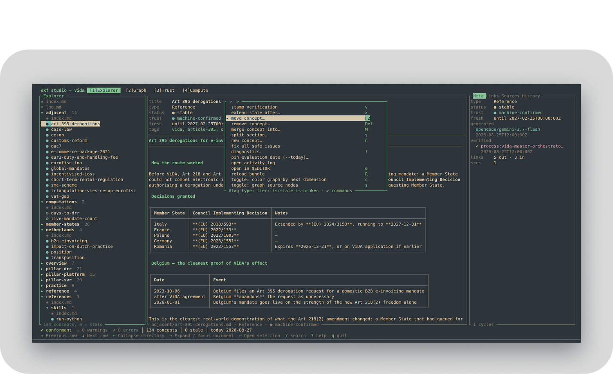

<div align="center">

# okf

A **pure-Rust** implementation, library and CLI toolkit for the [Open Knowledge Format (OKF) v0.3](https://github.com/open-knowledge-format/open-knowledge-format/blob/main/SPEC.md): an open, vendor-neutral, human- and agent-friendly format for representing knowledge as a directory of Markdown files with YAML frontmatter.

[](https://crates.io/crates/okf)
[](https://crates.io/crates/okf-core)
[](https://docs.rs/okf)
[](https://github.com/W4G1/okf/actions/workflows/rust.yml)
[](#license)
[](https://crates.io/crates/okf/dependencies)

<br/>
<br/>



</div>

---

## Table of Contents

<details>
<summary>Click to expand</summary>

- [What is OKF?](#what-is-okf)
- [Hands-on quickstart (60 seconds)](#hands-on-quickstart-60-seconds)
  - [1. Install the CLI](#1-install-the-cli)
  - [2. Initialize a new bundle](#2-initialize-a-new-bundle)
  - [3. Create concepts](#3-create-concepts)
  - [4. Check conformance and auto-fix issues](#4-check-conformance-and-auto-fix-issues)
  - [5. Inspect trust and visualize the graph](#5-inspect-trust-and-visualize-the-graph)
  - [6. Explore with OKF Studio](#6-explore-with-okf-studio)
- [Interactive studio: `okf studio`](#interactive-studio-okf-studio)
- [Anatomy of an OKF bundle](#anatomy-of-an-okf-bundle)
  - [Directory structure](#directory-structure)
  - [Concept document example](#concept-document-example)
  - [Attested computation example](#attested-computation-example)
- [Core concepts](#core-concepts)
  - [What counts as a concept](#what-counts-as-a-concept)
  - [Trust tiers](#trust-tiers)
  - [Freshness and staleness](#freshness-and-staleness)
  - [Lifecycle and replacement](#lifecycle-and-replacement)
  - [Links and paths](#links-and-paths)
  - [Provenance and footnote attribution](#provenance-and-footnote-attribution)
  - [Attested computations](#attested-computations)
- [Upgrading a bundle from OKF v0.2](#upgrading-a-bundle-from-okf-v02)
- [CLI reference and workflows](#cli-reference-and-workflows)
  - [Interactive studio: studio](#interactive-studio-studio)
  - [Scaffolding: init and new](#scaffolding-init-and-new)
  - [Bundle manipulation: mv, rm, split, and merge](#bundle-manipulation-mv-rm-split-and-merge)
  - [Quality gate: validate and lint](#quality-gate-validate-and-lint)
  - [Auditing trust: trust and info](#auditing-trust-trust-and-info)
  - [Link graph and discovery: links and graph](#link-graph-and-discovery-links-and-graph)
  - [Listing computations: computations](#listing-computations-computations)
  - [Semantic diffs: diff](#semantic-diffs-diff)
  - [Formatting and indexing: fmt, index, and parse](#formatting-and-indexing-fmt-index-and-parse)
  - [Universal JSON output: --json / -j](#universal-json-output---json---j)
- [CI/CD integration](#cicd-integration)
- [Using as a Rust library](#using-as-a-rust-library)
  - [1. Loading and validating a bundle](#1-loading-and-validating-a-bundle)
  - [2. Inspecting attested computations](#2-inspecting-attested-computations)
  - [3. Multi-language syntax checking](#3-multi-language-syntax-checking)
- [Workspace crates](#workspace-crates)
- [Design choices](#design-choices)
- [Mapping to the spec](#mapping-to-the-spec)
- [License](#license)

</details>

---

## What is OKF?

The **Open Knowledge Format (OKF)** is an open specification for representing written knowledge as a directory of Markdown files with structured YAML frontmatter. It was first published by Google and is developed at [open-knowledge-format/open-knowledge-format](https://github.com/open-knowledge-format/open-knowledge-format).

An OKF bundle is plain text in a folder. There is no database, no external service, and no schema registry. If you can read a text file, you can read OKF.

- **Concepts**: Individual Markdown documents (`.md`), each containing one piece of knowledge with YAML frontmatter. The only required key is `type`.
- **Bundles**: A directory tree of related concepts. An `index.md` file acts as the directory listing, and `log.md` records revision history. The bundle-root `index.md` also carries the bundle metadata: `okf_version`, `title`, `description`, and `license`.
- **Trust & verification**: Frontmatter tracks who authored a concept (`generated: { by, at }`) and who or what verified it (`verified: [{ by, at }]`). Trust tiers (`unverified`, `machine-confirmed`, `human-reviewed`) are derived dynamically from the verifications that are still current.
- **Freshness & lifecycle**: Concepts define status (`draft`, `stable`, `deprecated`), a replacement for a retired concept (`superseded_by`), and an explicit review date (`stale_after`).
- **Provenance**: Sources list where knowledge originated, who wrote it, and when it changed, with footnote citations linking claims directly to source IDs.
- **Attested computations**: Executable contracts specifying parameters, runtimes (SQL, Python, dbt), execution receipts, and deterministic verification attesters.

The `okf` crate is a pure-Rust implementation, validator, linter, and CLI toolkit for working with OKF v0.3 bundles. Bundles written for OKF v0.2 and v0.1 still load: the specification's fallbacks for earlier versions are applied, and `okf validate --fix` migrates them (see [Upgrading a bundle from OKF v0.2](#upgrading-a-bundle-from-okf-v02)).

---

## Hands-on quickstart (60 seconds)

### 1. Install the CLI

Install `okf` from crates.io:

```sh
cargo install okf
```

*(Or install as a Cargo plugin via `cargo install cargo-okf`, which lets you run `cargo okf <command>`)*

### 2. Initialize a new bundle

Create an OKF bundle with a root `index.md`, audit `log.md`, and an initial concept. The title and description go into the bundle metadata; an agent with access to many bundles reads the description to choose one:

```sh
okf init company_knowledge --title "Company policies and operations" \
  --description "HR and finance policies and their sanctioned computations. Use it for expense and time-off questions."
cd company_knowledge
```

### 3. Create concepts

Scaffold new concepts with standardized frontmatter:

```sh
# Create a policy concept
okf new policies/travel_expenses --type Policy --title "Travel and expense policy" --description "Rules and reimbursement rates for business travel."

# Create an Attested Computation contract
okf new computations/mileage_calc --attested --title "Mileage reimbursement calculator"
```

### 4. Check conformance and auto-fix issues

Run `validate` and `lint` to audit your bundle:

```sh
# Validate OKF v0.3 conformance
okf validate .

# Run opinionated hygiene checks and automatically remediate fixable issues
okf lint . --fix
```

### 5. Inspect trust and visualize the graph

```sh
# View trust tiers and staleness status
okf trust .

# Generate a Mermaid graph of concept relationships (renders directly in GitHub Markdown)
okf graph . --format mermaid
```

### 6. Explore with OKF Studio

```sh
okf studio .
```

---

## Interactive studio: okf studio

`okf studio` is an interactive terminal interface for exploring and managing OKF bundles.

Unlike one-off commands that run once and exit, the studio stays open and automatically updates when files are edited on disk.

- **Browse and read**: Navigate directories, read rendered Markdown, follow links, and inspect metadata and revision history.
- **Visual link graph**: Explore connections and dependencies between concepts interactively.
- **Audit bundle health**: View trust levels, freshness, and concepts that need attention.
- **Computations**: Inspect Attested Computation contracts and test parameter inputs.
- **Refactor safely**: Move, rename, merge, split, or delete concepts with preview confirmation before changes are saved.

```sh
okf studio [bundle]
```

---

## Anatomy of an OKF bundle

### Directory structure

A typical OKF bundle repository looks like this:

```text
company_knowledge/
├── index.md                      # Root listing + bundle metadata (okf_version: "0.3", title, description, license)
├── log.md                        # Audit log of changes grouped by ISO-8601 date (no frontmatter)
├── README.md                     # No frontmatter, so not a concept: skipped by consumers
├── policies/
│   ├── index.md                  # Subdirectory index (auto-generated, no frontmatter)
│   ├── travel_expenses.md        # Concept document (Policy)
│   └── paid_time_off.md          # Concept document (Policy)
├── computations/
│   ├── index.md                  # Subdirectory index (auto-generated)
│   └── mileage_calc.md           # Attested Computation concept
└── references/
    ├── skills/submit_expense.md  # Execution instructions
    └── attesters/verify_rate.py  # Deterministic verifier (an asset, not a concept)
```

The bundle-root `index.md` opens with the bundle metadata. Regenerating the index keeps this block exactly as written:

```markdown
---
okf_version: "0.3"
title: Company policies and operations
description: HR and finance policies and their sanctioned computations. Use it for expense and time-off questions.
license: CC-BY-4.0
---

# Subdirectories

* [computations](computations/index.md) - Sanctioned computation to calculate employee vehicle travel reimbursement.
* [policies](policies/index.md) - Contains 2 entries: Paid time off, Travel and expense policy.
```

### Concept document example

`policies/travel_expenses.md`:

```markdown
---
type: Policy
title: Travel and expense policy
description: Rules and standard per-mile reimbursement rates for employee travel.
tags: [hr, finance, travel, expenses]
status: stable
generated:
  by: reference_agent/gemini-3.7-flash
  at: "2026-06-20T22:53:05Z"
verified:
  by: "human:sarah_hr"
  at: "2026-06-25T09:00:00Z"
stale_after: "2026-12-31T00:00:00Z"
sources:
  - id: mileage-guide
    resource: https://example.com/finance/mileage-guide
    title: Standard mileage reimbursement guidelines
---

# Travel and expense policy

Employees traveling on company business are reimbursed for personal vehicle usage at standard approved rates.[^mileage-guide]

Total reimbursement is calculated using the [Mileage reimbursement calculator](../computations/mileage_calc.md).

[^mileage-guide]: Standard mileage reimbursement guidelines
```

### Attested computation example

`computations/mileage_calc.md`:

````markdown
---
type: Attested Computation
title: Mileage reimbursement calculator
description: Sanctioned computation to calculate employee vehicle travel reimbursement.
status: stable
runtime: python
parameters:
  - { name: miles, type: number, required: true }
  - { name: rate_per_mile, type: number, required: false }
executor:
  resource: /references/skills/submit_expense.md
  receipt: [report_id, calculated_amount, status]
attester:
  resource: /references/attesters/verify_rate.py
generated:
  by: "human:alex_finance"
  at: "2026-06-15T10:00:00Z"
verified:
  by: "process:ci-nightly"
  at: "2026-06-20T00:00:00Z"
---

# Mileage reimbursement calculator

# Computation

```python
def calculate_reimbursement(miles: float, rate_per_mile: float = 0.67) -> float:
    return round(miles * rate_per_mile, 2)
```
````

---

## Core concepts

### What counts as a concept

A `.md` file is a concept when its frontmatter has a non-empty `type`. Everything else in the directory is something a bundle may hold without it being knowledge:

- A `.md` file with no frontmatter, or no `type`, is **not a concept**. Consumers skip it and it never affects conformance, so a `README.md` or a `SKILL.md` can live in a bundle. `okf validate` warns about each one in case a concept was meant.
- `index.md` and `log.md` are reserved and are never concepts.
- A file that does not end in `.md` is an **asset**. A link or a path field may point at it.
- Files and directories whose names start with `.` are not part of the bundle, and a symbolic link that leads out of the bundle root is not followed.

### Trust tiers

In a corpus where both humans and AI agents write documents, trust is critical. OKF derives trust tiers dynamically from verification events rather than storing a subjective score:

| Trust tier | Meaning | Verification condition |
|------------|---------|------------------------|
| **`human-reviewed`** | Highest confidence. Verified by a human. | At least one current `verified.by` uses the `human:` scheme (e.g., `human:alice`). |
| **`machine-confirmed`** | Moderate confidence. Checked by automated process or test suite. | Current verifications from other actors only (`process:nightly-ci`, `team:finance`, `agent/v1`). |
| **`unverified`** | Baseline draft or unreviewed agent output. | No current `verified` entries. |

Only **current** events count: a verification is current when its `at` is at or after `generated.at`, the time the content last changed. When an agent rewrites a concept after a human review, the human did not read the new text, so the concept is not human-reviewed until a human confirms it again. Earlier events stay in the file as history; `okf trust` marks them `(before the last change)`.

Actors are written `<producer>/<version>` for an agent or tool, or `<scheme>:<id>` for anything else. OKF defines the schemes `human:`, `team:`, and `process:`; other schemes are accepted and treated as non-human.

### Freshness and staleness

Knowledge decays over time. The `stale_after` field gives a concept an explicit review date. Like every OKF timestamp it is an RFC 3339 date-time with an offset (`"2026-12-31T00:00:00Z"`) or a date (`"2026-12-31"`, the start of that day in UTC).

- `okf trust .` flags stale concepts in terminal output.
- Staleness is judged against the current time. `okf validate . --today 2026-07-01` pins a day instead (judged at its start, in UTC), which keeps a CI run reproducible. `--at 2026-07-01T09:30:00+02:00` pins an exact instant; it takes a full RFC 3339 date-time with an offset and cannot be combined with `--today`. `validate`, `lint`, `info`, `trust`, `parse`, and `studio` accept both.
- A `stale_after` that does not parse is never treated as fresh: the concept counts as stale and the value is reported as malformed.

Stale means the content needs to be checked again, not that it is false. Freshness and trust are independent.

### Lifecycle and replacement

`status` is `draft`, `stable` (the default), or `deprecated`. A deprecated concept is kept for links and history; it can name what replaces it:

```yaml
status: deprecated
superseded_by: /metrics/gross-margin.md
```

A consumer that filters to current knowledge follows `superseded_by` to the replacement (`Bundle::current_replacement` in the library). A status outside the three values is kept and shown, but the concept is not treated as current. `okf mv --leave-stub` writes such a stub at the old path when you move a concept.

### Links and paths

A Markdown link and a frontmatter **path field** (`resource`, `sources[].resource`, `computation`, `executor.resource`, `attester.resource`, `superseded_by`) resolve the same way:

1. A value with a URI scheme (`https:`) is an absolute URL.
2. A value that starts with `/` resolves from the bundle root.
3. Any other value resolves from the directory of the file that contains it.

A value that leaves the bundle root is external and is never read from disk. Paths are case-sensitive and are URI references, so a space is written `%20`. Both kinds of reference are edges of the bundle graph: `okf graph --fields` shows the path-field edges beside the links, and `okf mv` keeps both intact.

A link to an asset or to a `.md` file that is not a concept is valid; it just does not refer to a concept. Only a target that names nothing is reported as broken.

### Provenance and footnote attribution

OKF documents record origin and credibility signals under `sources`:

```yaml
sources:
  - id: mileage-guide
    resource: https://example.com/finance/mileage-guide
    title: Standard Mileage Reimbursement Guidelines
    author: "team:finance"
    last_modified: "2026-04-01T00:00:00Z"
    usage_count: 1200
usage_window: { from: "2026-03-01", to: "2026-03-31" }
```

Inline claims reference sources via standard Markdown footnotes keyed to `sources[].id` (e.g., `According to company guidelines...[^mileage-guide]`).

### Attested computations

An `Attested Computation` defines a contract for executing deterministic calculations:
1. **`runtime`**: Environment (e.g., `python`, `bigquery`, `dbt`, `snowflake`). Required.
2. **`parameters`**: Typed arguments an agent may fill; each has a `name` and a `type`.
3. **`# Computation`**: The code or query, as a fenced code block in a section with that heading, or as a file named by `computation`.
4. **`executor`**: Resource that executes the logic and returns a receipt.
5. **`attester`**: Deterministic script that verifies the receipt output.

A value may be shown as attested only when the concept has a `runtime`, an `attester`, and a computation that can be found. `okf computations` reports this per contract as `attestable`.

> **Note**: `okf` parses and validates attestation contracts; executing computation and attestation is a consumer-side runtime responsibility.

---

## Upgrading a bundle from OKF v0.2

OKF v0.3 changes how two existing values are read, and tightens a few rules. A v0.2 bundle keeps loading, because the fallbacks the specification allows for earlier versions are applied to any bundle that declares `okf_version` 0.2 or earlier, or no version. To bring a bundle up to v0.3:

```sh
okf validate ./company_knowledge          # see what v0.3 says about it
okf validate ./company_knowledge --fix    # apply the mechanical migrations
```

| Change in v0.3 | What happens to a v0.2 bundle | `--fix` |
|----------------|-------------------------------|---------|
| A path field without a leading `/` resolves from the directory of its file, not from the bundle root. | `executor.resource: references/skills/run.md` still resolves through the fallback, with a warning. Once the bundle declares 0.3 it would not. | Rewrites it as `/references/skills/run.md`. |
| Only verifications at or after `generated.at` give the trust tier. | Concepts rewritten after their last review drop to a lower tier. Reported as an info note. | Nothing to fix: re-verify the concept. |
| `log.md` has no frontmatter. | A conformance error. | Removes the block. |
| A scalar `tags` value is one tag. | `tags: sales, orders` reads as the single tag `sales, orders`. | Rewrites it as a list of two tags. |
| The computation is the first *fenced* block of the `Computation` section. | An indented block is still read but is not attestable. | Fences it. |
| A date-time needs an offset; a date alone is valid and means the start of that day in UTC. | An offset-less date-time is malformed. | Adds `Z` (UTC is assumed, and the report says so). |
| The bundle-root `index.md` declares `okf_version` and may carry `title`, `description`, `license`. | A warning if the version is missing. | Declares `okf_version: "0.3"` once no path depends on the fallback. |

A fix rewrites only what it changes. Frontmatter entries it does not touch keep their quoting, their flow or block style, and their comments, and a Markdown file that is not a concept is left alone. Use `okf fmt` when you do want the whole layout normalized.

Two things remain for a person: add `superseded_by` to deprecated concepts that have a replacement, and add a `title` and `description` to the bundle metadata.

---

## CLI reference and workflows

```text
okf <command> [options] [arguments]
```

### Interactive studio: studio

Open the interactive terminal UI:

```sh
# Open the current directory in studio
okf studio

# Open a specific bundle and start on the graph tab
okf studio ./company_knowledge --tab graph

# Check staleness against a pinned date and set an author identity
okf studio ./company_knowledge --today 2026-12-01 --author "human:sarah"

# Or against an exact instant (verification stamps still record the actual time)
okf studio ./company_knowledge --at 2026-12-01T09:30:00Z
```

### Scaffolding: init and new

```sh
# Initialize a new bundle in the current directory
okf init . --title "Company policies"

# Write the full bundle metadata: what the bundle covers, and its license
okf init ./company_knowledge --title "Company policies" \
  --description "HR and finance policies. Use it for expense and time-off questions." \
  --license CC-BY-4.0

# Initialize a bare bundle without sample concept
okf init ./company_knowledge --bare

# Create a new concept with title and description
okf new policies/travel_expenses --type Policy --title "Travel and expense policy" --description "Rules and reimbursement rates for business travel"

# Create an Attested Computation concept
okf new computations/mileage_calc --attested --title "Mileage reimbursement calculator"
```

### Bundle manipulation: mv, rm, split, and merge

Manipulating and refactoring a bundle without breaking cross-links is a first-class capability in `okf`:

```sh
# Move or rename a concept (rewrites all backlinks and path fields across the bundle + rebases outgoing links and anchors)
okf mv auth/token security/jwt --bundle ./company_knowledge

# Preview rename without writing to disk
okf mv auth/token security/jwt --dry-run --json

# Keep a deprecated stub at the old path with `superseded_by` set to the new one,
# so references stored outside the bundle keep leading somewhere
okf mv auth/token security/jwt --leave-stub

# Rename a section/heading in-place and rewrite all internal and bundle-wide anchor links
okf mv billing/pricing#pricing-tiers billing/pricing#subscription-plans

# Safely remove a concept (fails if a link or a path field still points to it)
okf rm legacy/old_policy

# Re-route all backlinks and path fields pointing to the removed concept to a replacement
okf rm legacy/old_policy --redirect-to policies/new_policy

# Unlink backlinks into plain text
okf rm legacy/old_policy --unlink

# Extract a section/heading into a new concept document
okf split billing/pricing billing/enterprise --section "Enterprise Tier" --title "Enterprise Pricing"

# Consolidate two concepts into one (merges sources, footnotes, verified events, and backlinks)
okf merge billing/discounts billing/pricing
```

### Quality gate: validate and lint

`okf validate` checks OKF v0.3 conformance and exits with a non-zero code on errors. Only two things are errors, the same two the specification names: a frontmatter block that does not parse as a YAML mapping with unique keys, and a reserved `index.md` or `log.md` that does not follow its structure (frontmatter in `log.md` or in a subdirectory `index.md`, or a `log.md` date heading that is not `YYYY-MM-DD`). Everything else it reports is a warning (a value that does not follow the spec, a path field that does not resolve, a malformed timestamp) or an info note (a broken link, a stale concept, a verification that is no longer current):

```sh
# Conformance check
okf validate ./company_knowledge

# Check conformance against a specific evaluation date
okf validate ./company_knowledge --today 2026-12-01

# Or against an exact instant (RFC 3339 with an offset)
okf validate ./company_knowledge --at 2026-12-01T09:30:00+01:00

# Automatically fix what can be fixed (and migrate v0.1 and v0.2 forms)
okf validate ./company_knowledge --fix
```

`okf lint` evaluates 13 opinionated hygiene rules (missing headings, orphan concepts, key ordering, heading hierarchy, whitespace issues):

```sh
# Lint bundle
okf lint ./company_knowledge

# Automatically apply fixes across all files (adds titles, headings, orders keys, fixes whitespace)
okf lint ./company_knowledge --fix
```

Neither `--fix` reformats what it does not fix: untouched frontmatter entries are written back exactly as they were. `okf fmt` is the command that normalizes layout.

### Auditing trust: trust and info

```sh
# View per-concept trust tier, verification history, and staleness
okf trust ./company_knowledge
```

*Example Output:*
```text
computations/mileage_calc [stable] machine-confirmed
  generated: human:alex_finance at 2026-06-15T10:00:00Z
  verified:  process:ci-nightly at 2026-06-20T00:00:00Z
policies/old_travel [deprecated] unverified
  superseded_by: policies/travel_expenses
  generated: reference_agent/gemini-3.7-flash at 2026-03-01T08:00:00Z
  verified:  human:sarah_hr at 2026-02-10T09:00:00Z (before the last change)
policies/travel_expenses [stable] human-reviewed
  generated: reference_agent/gemini-3.7-flash at 2026-06-20T22:53:05Z
  verified:  human:sarah_hr at 2026-06-25T09:00:00Z
  stale_after: 2026-12-31T00:00:00Z
  source:    [mileage-guide] Standard mileage reimbursement guidelines

3 concept(s):
     1  unverified
     1  machine-confirmed
     1  human-reviewed
```

```sh
# Summarize the bundle: its metadata, types, trust tiers, statuses, and health
okf info ./company_knowledge
```

### Link graph and discovery: links and graph

```sh
# Inspect all internal and broken cross-links
okf links ./company_knowledge

# Check only for broken links (fails in CI if broken links exist)
okf links ./company_knowledge --broken --check

# Export cross-links in JSON format
okf links ./company_knowledge --format json

# Render link graph as Mermaid (ideal for GitHub READMEs or PR summaries)
okf graph ./company_knowledge --format mermaid --sources

# Include every path field that names a concept: sources, executors, superseded_by
okf graph ./company_knowledge --fields

# Export full dependency graph as JSON
okf graph ./company_knowledge --format json --fields
```

`okf links` separates a link to a concept (`[ok]`), a link to an asset or to a file that is not a concept (`[file]`), and a link whose target names nothing (`[broken]`).

### Listing computations: computations

Inspect and list all `Attested Computation` contracts declared in the bundle:

```sh
# List all attested computation contracts, and whether each is attestable
okf computations ./company_knowledge
```

### Semantic diffs: diff

Perform semantic comparison between two OKF bundles (or two git worktrees):

```sh
okf diff ./bundle_v1 ./bundle_v2
```

*Example Output:*
```text
added (1):
  + policies/paid_time_off
removed (0):
renamed (1):
  ~ policies/old_travel -> policies/travel_expenses
content (1):
  ~ policies/travel_expenses (body)
trust (1):
  policies/travel_expenses: tier unverified -> human-reviewed
added links (1):
  + policies/travel_expenses -> computations/mileage_calc
```

### Formatting and indexing: fmt, index, and parse

```sh
# Dry-run format check for CI (exits with non-zero code if files need formatting)
okf fmt ./company_knowledge --check

# Rewrite frontmatter into the canonical block style, in place, for every concept
# (log.md, and Markdown files that are not concepts, are left as written)
okf fmt ./company_knowledge -w

# Regenerate all index.md table-of-contents files across the directory tree
# (the bundle metadata of the root index.md is kept exactly as written)
okf index ./company_knowledge

# Inspect AST and parsed frontmatter structure of a single document
okf parse ./company_knowledge/policies/travel_expenses.md
```

### Universal JSON output: `--json` / `-j`

Every CLI subcommand supports machine-readable JSON output via `--json` (or `-j` / `--format json`) for automated pipelines and AI agent tool calling:

```sh
okf validate ./company_knowledge --json
okf lint ./company_knowledge --json
okf info ./company_knowledge --json
okf trust ./company_knowledge --json
okf fmt ./company_knowledge --check --json
okf diff ./bundle_v1 ./bundle_v2 --json
```

---

## CI/CD integration

Add `okf` to your GitHub Actions workflow to automatically check every pull request:

`.github/workflows/okf.yml`:

```yaml
name: Bundle CI

on:
  push:
    branches: [main]
  pull_request:
    branches: [main]

jobs:
  validate:
    name: Conformance and lint
    runs-on: ubuntu-latest
    steps:
      - uses: actions/checkout@v4

      - name: Install Rust toolchain
        uses: dtolnay/rust-toolchain@stable

      - name: Install okf
        run: cargo install okf

      - name: Check formatting
        run: okf fmt ./company_knowledge --check

      - name: Validate OKF conformance
        run: okf validate ./company_knowledge

      - name: Check broken links
        run: okf links ./company_knowledge --broken --check

      - name: Lint bundle
        run: okf lint ./company_knowledge
```

---

## Using as a Rust library

Add `okf` or `okf-core` to your `Cargo.toml`:

```sh
cargo add okf
```

The `okf` crate's features let you take only what you need. `validator` and
`studio` are on by default, as are the four language parsers behind the
validator's syntax checks: `python`, `javascript`, `rust`, and `sql`. Each
parser can be dropped independently. This matters under a strict dependency
or licence policy: the Python parser (`rustpython-parser`) depends on the
LGPL-3.0-only `malachite` crates, which an allow-list policy such as
`cargo deny` will reject. Conformance validation and linting need none of
the parsers, so a licence-clean dependency that still checks SQL is:

```toml
[dependencies]
okf = { version = "0.3", default-features = false, features = ["validator", "sql"] }
```

Or, without any of the validator, `okf-core` alone for a zero-dependency
model and parser. See the [`okf-validator` README](crates/okf-validator/README.md#cargo-features)
for the full feature table.

### 1. Loading and validating a bundle

```rust,no_run
use okf::{Bundle, ConceptId, Date, Freshness, TrustTier, validate_bundle};

// Load bundle from disk
let bundle = Bundle::load("./company_knowledge")?;
println!("Loaded {} concepts", bundle.len());
if let Some(description) = &bundle.metadata().description {
    println!("Scope: {description}");
}

// Conformance check
let report = validate_bundle(&bundle);
if report.is_conformant() {
    println!("Conformant with OKF v{}", okf::OKF_VERSION);
}

// Traverse cross-links and backlinks
let policy_id = ConceptId::parse("policies/travel_expenses")?;
for link in bundle.links_from(&policy_id) {
    println!("{} -> {} (exists: {})", policy_id, link.target, link.exists);
}
for backlink in bundle.backlinks(&policy_id) {
    println!("Referenced by backlink: {backlink}");
}
// Path fields that name a concept are edges of the bundle graph too
for edge in bundle.path_edges_from(&policy_id) {
    println!("{} names {} in `{}`", policy_id, edge.target, edge.field);
}

// Check trust, freshness, and lifecycle
let now = Date::today_utc().unwrap().to_utc_datetime();
for concept in bundle.concepts() {
    // The tier counts only verifications made after the last change.
    if concept.trust_tier() < TrustTier::HumanReviewed {
        println!("{} has no current human review", concept.id);
    }
    match concept.freshness_at(now) {
        Freshness::Stale => println!("{} is past its stale_after", concept.id),
        Freshness::Malformed => println!("{} has a malformed stale_after", concept.id),
        Freshness::Fresh | Freshness::Undated => {}
    }
    // A deprecated concept may name its replacement.
    if !concept.is_current()
        && let Some(replacement) = bundle.current_replacement(&concept.id)
    {
        println!("{} is replaced by {}", concept.id, replacement.id);
    }
}
# Ok::<(), Box<dyn std::error::Error>>(())
```

### 2. Inspecting attested computations

````rust
use okf::Document;

let doc = Document::parse(
    "---\n\
     type: Attested Computation\n\
     runtime: python\n\
     parameters:\n\
     \x20 - { name: miles, type: number, required: true }\n\
     executor:\n\
     \x20 resource: /references/skills/submit_expense.md\n\
     \x20 receipt: [report_id, calculated_amount, status]\n\
     attester:\n\
     \x20 resource: /references/attesters/verify_rate.py\n\
     ---\n\n# Computation\n\n\
     ```python\n\
     def calculate_reimbursement(miles: float, rate_per_mile: float = 0.67) -> float:\n\
     \x20   return round(miles * rate_per_mile, 2)\n\
     ```\n",
)?;

let contract = doc.attested_computation().unwrap();
assert_eq!(contract.runtime.as_deref(), Some("python"));
assert_eq!(contract.required_parameters().count(), 1);
assert!(contract.computation.code().unwrap().contains("calculate_reimbursement"));
// A runtime, an attester, and a fenced computation: its values can be attested.
assert!(contract.is_attestable());
# Ok::<(), okf::DocumentError>(())
````

---

### 3. Multi-language syntax checking

```rust,no_run
use okf::{Bundle, check_syntax, lint_bundle};

let bundle = Bundle::load("./company_knowledge")?;
let report = lint_bundle(&bundle);

for diagnostic in report.diagnostics {
    println!("{diagnostic}");
}

// Check syntax directly for any supported language
assert!(check_syntax("python", "def calculate(total):
    return total * 0.2
").is_ok());
assert!(check_syntax("typescript", "const add = (a: number, b: number): number => a + b;").is_ok());
# Ok::<(), Box<dyn std::error::Error>>(())
```

Python, JavaScript/TypeScript, Rust, and SQL checking each sit behind a
cargo feature of the same name (all on by default; see above). With a
feature disabled, `check_syntax` accepts that language unchecked and
`Language::is_supported` tells you so. JSON, YAML, and Bash are always
checked.

---

## Workspace crates

This repository is structured as a multi-crate Rust workspace:

| Crate | Description | Documentation |
|-------|-------------|---------------|
| [`okf`](https://crates.io/crates/okf) | CLI binary and re-exports of all core and validator APIs. | [](https://docs.rs/okf) |
| [`okf-core`](https://crates.io/crates/okf-core) | Pure-Rust OKF engine (YAML subset parser, AST, link graphs, diff, fix engine). | [](https://docs.rs/okf-core) |
| [`okf-validator`](https://crates.io/crates/okf-validator) | Conformance validator, multi-language syntax checker, and 13 opinionated linting rules. | [](https://docs.rs/okf-validator) |
| [`okf-studio`](https://crates.io/crates/okf-studio) | The `okf studio` interactive terminal UI: explorer, graph, mission control, computations playground, and live refactoring. | [](https://docs.rs/okf-studio) |
| [`cargo-okf`](https://crates.io/crates/cargo-okf) | Cargo plugin wrapper allowing `cargo okf <cmd>`. | [](https://docs.rs/cargo-okf) |

---

## Design choices

- **Full frontmatter preservation:** Rather than deserializing into rigid structs (which would drop custom or extension keys), `Frontmatter` maintains an order-preserving map and layers typed accessors on top. Unknown keys survive round-trips untouched, at any depth.
- **Minimal rewrites:** A producer should not re-serialize values it did not change. A document that is edited and written back keeps every untouched frontmatter entry byte for byte: its quoting, its flow or block style, and its comments. Refactors, fixes, and index regeneration change only the lines they have to; `okf fmt` is the one command that normalizes layout, because that is what it is asked to do.
- **Computed, not stored, trust signals:** Trust tiers and credibility signals are derived at query time from verified actors. Storing a subjective trust number is fragile and non-portable.
- **Permissive and resilient loading:** `Bundle::load` never crashes on a single broken file; parse errors and broken links are collected as diagnostic graph items so you can inspect and fix them. The typed accessors apply the specification's rules for values that are absent, empty, or oddly shaped, so a scalar `tags` reads as one tag and an entry without its required key is ignored.
- **Never read outside the bundle:** a path that climbs out of the bundle root, or a symbolic link that leads out of it, is treated as external and is not opened.
- **Deterministic by default:** `validate_bundle` never looks at the clock; staleness is checked only when a time is passed in (`validate_bundle_at`, `validate_bundle_at_instant`). The CLI judges staleness at the current time, and `--today` pins a day, or `--at` an exact instant, so that a run is reproducible.

---

## Mapping to the spec

| Spec section | Responsibility | Module |
|--------------|----------------|--------|
| §2 Terminology / Concept ID | Identifier normalization & path resolution | [`concept_id::ConceptId`](https://docs.rs/okf/latest/okf/concept_id/struct.ConceptId.html) |
| §3 Bundle structure | Directory traversal, reserved files, which files are concepts | [`bundle::Bundle`](https://docs.rs/okf/latest/okf/bundle/struct.Bundle.html), [`bundle::NonConcept`](https://docs.rs/okf/latest/okf/bundle/struct.NonConcept.html) |
| §4 Concept documents | Document AST, YAML frontmatter, body, extension keys | [`document::Document`](https://docs.rs/okf/latest/okf/document/struct.Document.html), [`frontmatter::Frontmatter`](https://docs.rs/okf/latest/okf/frontmatter/struct.Frontmatter.html) |
| §5 Timestamps | RFC 3339 date-times and dates | [`date::DateTimeField`](https://docs.rs/okf/latest/okf/date/struct.DateTimeField.html) |
| §5.1 Provenance | Sources, credibility signals, footnotes | [`provenance::Source`](https://docs.rs/okf/latest/okf/provenance/struct.Source.html), [`provenance::attributions`](https://docs.rs/okf/latest/okf/provenance/fn.attributions.html) |
| §5.2 Trust | `generated`, `verified` actors & timestamps | [`trust::Generated`](https://docs.rs/okf/latest/okf/trust/struct.Generated.html), [`trust::Verification`](https://docs.rs/okf/latest/okf/trust/struct.Verification.html) |
| §5.3 Trust tiers | `unverified`, `machine-confirmed`, `human-reviewed`, from current events | [`trust::TrustTier`](https://docs.rs/okf/latest/okf/trust/enum.TrustTier.html) |
| §5.4 / §5.5 Lifecycle | `status`, `superseded_by`, `stale_after` | [`trust::Status`](https://docs.rs/okf/latest/okf/trust/enum.Status.html), [`trust::Freshness`](https://docs.rs/okf/latest/okf/trust/enum.Freshness.html), [`Bundle::superseded_by`](https://docs.rs/okf/latest/okf/bundle/struct.Bundle.html#method.superseded_by) |
| §6 Links and paths | Link parsing, one resolution rule for links and path fields, the bundle graph | [`links`](https://docs.rs/okf/latest/okf/links/), [`Bundle::resolve_path`](https://docs.rs/okf/latest/okf/bundle/struct.Bundle.html#method.resolve_path), [`bundle::PathFieldEdge`](https://docs.rs/okf/latest/okf/bundle/struct.PathFieldEdge.html) |
| §7 Actor convention | `<producer>/<version>` and `<scheme>:<id>` (`human:`, `team:`, `process:`) | [`actor::Actor`](https://docs.rs/okf/latest/okf/actor/struct.Actor.html) |
| §8 Index files | Auto-generation of directory `index.md` listings; bundle metadata | [`index::regenerate_indexes`](https://docs.rs/okf/latest/okf/index/fn.regenerate_indexes.html), [`bundle::BundleMetadata`](https://docs.rs/okf/latest/okf/bundle/struct.BundleMetadata.html) |
| §9 Log files | Parsing and appending to `log.md` histories | [`log::Log`](https://docs.rs/okf/latest/okf/log/struct.Log.html) |
| §10 Attested computations | Contract models, parameters, attestability, and inline/external script syntax validation | [`computation::AttestedComputation`](https://docs.rs/okf/latest/okf/computation/struct.AttestedComputation.html), [`syntax::check_syntax`](https://docs.rs/okf/latest/okf/syntax/fn.check_syntax.html) |
| §11 Conformance | Conformance testing engine & diagnostic reporting | [`validate::validate_bundle`](https://docs.rs/okf/latest/okf/validate/fn.validate_bundle.html) |
| §12 Versioning | Fallbacks for bundles from earlier versions; migration | [`bundle::legacy_fallbacks_apply`](https://docs.rs/okf/latest/okf/bundle/fn.legacy_fallbacks_apply.html), [`fix::remediate_bundle`](https://docs.rs/okf/latest/okf/fix/fn.remediate_bundle.html) |

---

## License

Licensed under the **Apache License, Version 2.0**, matching the upstream [Open Knowledge Format](https://github.com/open-knowledge-format/open-knowledge-format) project. See [`LICENSE`](LICENSE) and [`NOTICE`](NOTICE) for details.

`okf-core` has no dependencies. The default build of `okf` and `okf-validator` pulls in third-party language parsers, one of which (`rustpython-parser`, behind the `python` feature) depends on LGPL-3.0-only crates. Consumers with a strict licence policy can disable that feature; see [Using as a Rust library](#using-as-a-rust-library).

*Disclaimer: This is an independent open-source implementation and is not affiliated with or endorsed by Google or the Open Knowledge Format project.*
